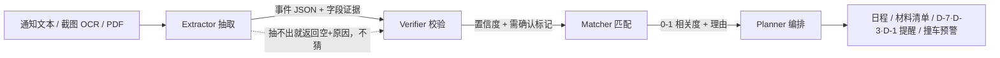

# Nudge · 校园截止管家

> **Not an alarm. A nudge.**
> 闹钟只负责响，Nudge 负责让你现在就动。

把「群里转发的通知」变成「今天该做什么」的 AI Agent。
面向高校学生：教务通知、竞赛报名、奖学金材料、讲座、四六级、在读证明——一句话或一张截图丢进来，10 秒内变成带截止时间、材料清单和提醒计划的待办。

---

## 1. 为什么不是又一个待办 App

学生真正的问题不是「没有日历」，而是：

1. **通知是自然语言**，截止时间藏在「11月20日17:00前」「本周五」里；
2. **信息在群里刷过去**，没人会手动录入；
3. **材料清单比截止时间更致命**——截止前 3 天才发现要学院盖章；
4. **同一天撞车**（11/20 既有四六级又有国奖），计划直接崩。

所以 Nudge 的定位是：**不是闹钟，是管家**。
它回答的不是「几点截止」，而是「**11/20 这天你有 3 个截止、2 个要盖章，建议 15 日前办完**」。

## 2. 四个 Agent 怎么分工



| Agent | 输入 → 输出 | 关键设计 |
|---|---|---|
| **Extractor** | 通知原文 → 事件 JSON | 规则优先（快、离线、可解释），LLM 只做补充；**每个字段必须回填原文证据** |
| **Verifier** | 事件 JSON + 原文 → 置信度 | 逐字段比对证据；证据不在原文里，该字段置信度直接降到 0.3 并标「需确认」 |
| **Matcher** | 事件 + 用户画像 → 相关度 | 年级/院系/兴趣加权，无关的沉底，避免「通知洪水」 |
| **Planner** | 事件 → 计划 | 材料 checklist、D-7/D-3/D-1 提醒、同日 ≥2 件撞车预警、周报 |

**一个刻意的取舍**：去重、排序、写日历、发提醒这些**确定性的活全部用代码做**，编排器是状态机而不是 LLM。
LLM 只出现在「理解自然语言」这一层——因为那才是它擅长、且错了也能被证据链抓住的地方。

## 3. 反幻觉：字段可以点回原文

界面里每个字段下面都挂着「原文：……」，来自 Extractor 的 evidence 字段。
Verifier 会检查这段引文是否**逐字**出现在通知里；不在，就降分并提示人工确认。
这让「AI 编了一个 11 月 30 日的截止时间」在结构上不可能悄悄发生。

## 4. 目录结构

```
nudge/
├─ backend/
│  ├─ app/
│  │  ├─ main.py            # FastAPI 路由
│  │  ├─ models.py          # Pydantic 契约（事件 JSON 就是 API 契约）
│  │  ├─ db.py              # SQLite：users / events / user_events / feedback
│  │  ├─ config.py          # MaaS 配置、提醒天数、负载阈值
│  │  ├─ agents/
│  │  │  ├─ extractor.py    # 规则抽取 + 可选 LLM 兜底
│  │  │  ├─ verifier.py     # 证据校验 + 置信度聚合
│  │  │  ├─ matcher.py      # 画像相关度
│  │  │  ├─ planner.py      # 紧急度 / checklist / 提醒 / 撞车
│  │  │  └─ llm.py          # DeepSeek OpenAI 兼容接口
│  │  ├─ services/
│  │  │  ├─ seed.py         # 6 条真实感示例通知
│  │  │  └─ ics.py          # 导出 .ics 日历订阅
│  │  └─ static/            # 单页前端（原生 JS，零构建）
│  └─ requirements.txt
├─ eval/
│  ├─ eval_set.json         # 20 条人工标注用例
│  ├─ run_eval.py           # 字段级准确率
│  └─ report.md             # 评测报告（自动生成）
└─ docs/
   ├─ ui.png                # 主界面
   └─ ui-draft.png          # 抽取结果（含证据链）
```

## 5. API

| 方法 | 路径 | 作用 |
|---|---|---|
| GET | /api/health | 健康检查 + LLM 可用性 |
| POST | /api/extract | 文本 → draft + 相关度 + checklist + 紧急度 |
| POST | /api/events | 确认后落库（按 title+deadline 去重） |
| GET | /api/events | 事件列表 |
| POST | /api/events/{id}/done | 标记完成 |
| GET | /api/dashboard | 统计、撞车预警、周报 |
| GET | /api/calendar/{token}.ics | 日历订阅（含 VALARM 提前 1 天） |
| POST | /api/feedback | 三键反馈（有用/无关/时间错） |
| GET | /api/settings | 读取模型接入地址/模型/是否已保存 Key |
| POST | /api/settings | 保存接入地址、模型、API Key（Key 不回显） |
| POST | /api/deploy | CI 钩子：git pull + 重载（需 `NUDGE_DEPLOY_TOKEN`，未配置时不存在） |

## 6. 模型接入

默认配置指向 DeepSeek：
- 接入地址：`https://api.deepseek.com`
- 模型：`deepseek-v4.1-flash`
- API Key：不写进仓库。首次使用点页面右上角「模型设置」填写；也可以设置环境变量 `MAAS_API_KEY`。

没有 Key 时自动回退纯规则，页面状态显示「规则模式」。填写后 `/api/health` 的 `llm` 变为 `true`，抽取走「规则 + 模型补充」，模型输出仍要过 `verifier` 的逐字证据校验。Key 只保存在本机 `backend/data/nudge.db`（已 gitignore），不会进入 release 源码包；这是单机演示的本地明文存储，生产环境应改用密钥管理服务。

## 7. 线上部署

已按 PythonAnywhere 免费计划设计：GitHub push → Actions → PA 上的 `/api/deploy` 自己拉代码并重载，不需要 SSH，也不需要常驻任务。

- 部署步骤、Secrets 配置、免费版限制、排错：[`docs/deploy-pythonanywhere.md`](docs/deploy-pythonanywhere.md)
- 手动兜底：PA 上执行 `bash ~/nudge/pythonanywhere/deploy.sh`
- 免费版出网白名单不含 DeepSeek，线上默认走规则引擎（`NUDGE_DISABLE_LLM=1`），这是设计内的降级

## 8. 已知限制

- 截图 OCR 依赖外部 OCR 服务，当前 Demo 只做文本入口（接口已预留 source_type=image）。
- 用户画像目前是写死的示例用户，接学校统一身份后应改为登录态。
- 大模型接入依赖页面设置或 `MAAS_API_KEY`；未配置时规则降级。评测脚本强制规则模式，避免模型版本影响 20/20 结果。
- 时区固定 Asia/Shanghai；跨时区交换生场景未处理。
- 20 条自建评测集偏小，规则对句式敏感；遇到「十一月底前」这类模糊表述会返回空而不是瞎猜（这是刻意的）。
