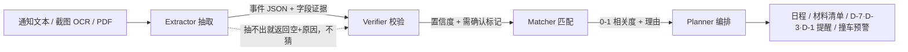

# Nudge · 校园截止管家

> **Not an alarm. A nudge.**
> 闹钟只负责响，Nudge 负责让你现在就动。

线上运行：**https://eternity0628.pythonanywhere.com** 

把「群里转发的通知」变成「今天该做什么」的 AI Agent。
面向高校学生：教务通知、竞赛报名、奖学金材料、讲座、四六级、在读证明——一句话或一张截图丢进来，10 秒内变成带截止时间、材料清单和提醒计划的待办。

---

## 1. 为什么不是又一个待办 App

学生真正的问题不是「没有日历」，而是：

1. **通知是自然语言**，截止时间藏在「11月20日17:00前」「本周五」里；
2. **信息在群里刷过去**，没人会手动录入；
3. **材料清单比截止时间更致命**——截止前 3 天才发现要学院盖章；
4. **同一天撞车**（11/20 既有四六级又有国奖），计划直接崩。

所以 Nudge 的定位是：**不是闹钟，是管家**。
它回答的不是「几点截止」，而是「**11/20 这天你有 3 个截止、2 个要盖章，建议 15 日前办完**」。

## 2. 四个 Agent 怎么分工



| Agent | 输入 → 输出 | 关键设计 |
|---|---|---|
| **Extractor** | 通知原文 → 事件 JSON | 规则优先（快、离线、可解释），LLM 只做补充；**每个字段必须回填原文证据** |
| **Verifier** | 事件 JSON + 原文 → 置信度 | 逐字段比对证据；证据不在原文里，该字段置信度直接降到 0.3 并标「需确认」 |
| **Matcher** | 事件 + 用户画像 → 相关度 | 年级/院系/兴趣加权，无关的沉底，避免「通知洪水」 |
| **Planner** | 事件 → 计划 | 材料 checklist、D-7/D-3/D-1 提醒、同日 ≥2 件撞车预警、周报 |

**一个刻意的取舍**：去重、排序、写日历、发提醒这些**确定性的活全部用代码做**，编排器是状态机而不是 LLM。
LLM 只出现在「理解自然语言」这一层——因为那才是它擅长、且错了也能被证据链抓住的地方。

## 3. 反幻觉：字段可以点回原文

界面里每个字段下面都挂着「原文：……」，来自 Extractor 的 evidence 字段。
Verifier 会检查这段引文是否**逐字**出现在通知里；不在，就降分并提示人工确认。
这让「AI 编了一个 11 月 30 日的截止时间」在结构上不可能悄悄发生。

## 4. 目录结构

```
nudge/
├─ backend/
│  ├─ app/
│  │  ├─ main.py            # FastAPI 路由
│  │  ├─ auth.py            # 登录 / 注册 / 重置 / 会话 / 管理员
│  │  ├─ models.py          # Pydantic 契约（事件 JSON 就是 API 契约）
│  │  ├─ db.py              # SQLite：users / events / feedback / settings
│  │  ├─ config.py          # .env 读取、MaaS 配置、Graph 邮箱配置
│  │  ├─ agents/
│  │  │  ├─ extractor.py    # 规则抽取 + 可选 LLM 兜底
│  │  │  ├─ verifier.py     # 证据校验 + 置信度聚合
│  │  │  ├─ matcher.py      # 画像相关度
│  │  │  ├─ planner.py      # 紧急度 / checklist / 提醒 / 撞车
│  │  │  └─ llm.py          # DeepSeek OpenAI 兼容接口
│  │  ├─ services/
│  │  │  ├─ accounts.py     # 口令哈希、会话、验证码发放与消费
│  │  │  ├─ mailer.py       # Microsoft Graph 发信 + 设备码授权 CLI
│  │  │  ├─ seed.py         # 6 条真实感示例通知
│  │  │  └─ ics.py          # 导出 .ics 日历订阅
│  │  └─ static/            # 单页前端（原生 JS，零构建）
│  └─ requirements.txt
├─ eval/
│  ├─ eval_set.json         # 20 条人工标注用例
│  ├─ run_eval.py           # 字段级准确率
│  └─ report.md             # 评测报告（自动生成）
└─ docs/
   ├─ ui.png                # 主界面
   └─ ui-draft.png          # 抽取结果（含证据链）
```

## 5. API

| 方法 | 路径 | 作用 |
|---|---|---|
| GET | /api/health | 健康检查 + LLM 可用性 |
| POST | /api/extract | 文本 → draft + 相关度 + checklist + 紧急度 |
| POST | /api/events | 确认后落库（按 title+deadline 去重） |
| GET | /api/events | 事件列表 |
| POST | /api/events/{id}/done | 标记完成 |
| GET | /api/dashboard | 统计、撞车预警、周报 |
| GET | /api/calendar/{token}.ics | 日历订阅（含 VALARM 提前 1 天） |
| POST | /api/feedback | 三键反馈（有用/无关/时间错） |
| GET | /api/settings | 读取模型接入地址/模型/是否已保存 Key |
| POST | /api/settings | 保存接入地址、模型、API Key（Key 不回显；存了 Key 自动切 `model` 模式） |
| GET | /api/llm-test?kind=chat\|models | 真发一次最小请求，返回状态码/报错原文，用来排查 Key 与模型名 |
| POST | /api/deploy | CI 钩子：git pull + 重载（需 `NUDGE_DEPLOY_TOKEN`，未配置时不存在） |

## 6. 模型接入

默认配置指向 DeepSeek：
- 接入地址：`https://api.deepseek.com`
- 模型：`deepseek-flash`（`/v1/models` 实际返回的可用 id；早期 `deepseek-v4.1-flash` 不被接口接受）
- API Key：不写进仓库。首次使用点页面右上角「模型设置」填写；也可以设置环境变量 `MAAS_API_KEY`。

没有 Key 时自动回退纯规则，页面状态显示「规则模式」。填写后 `/api/health` 的 `llm` 变为 `true`，抽取走「规则 + 模型补充」，模型输出仍要过 `verifier` 的逐字证据校验。Key 只保存在本机 `backend/data/nudge.db`（已 gitignore），不会进入 release 源码包；这是单机演示的本地明文存储，生产环境应改用密钥管理服务。

## 6.1 登录与多用户

进入站点先登录。支持邮箱+密码登录、昵称/邮箱/密码/验证码注册、邮箱验证码重置密码；密码框可切换明文查看。登录成功后跳转到独立的 `/app` 或 `/admin` 页面，不和登录表单共用一个滚动页；管理员邮箱登录自动进入管理端，可查看和删除用户；删除用户会清理其事件、反馈和会话。

验证码由 `Eternity070628@outlook.com` 本人通过 **Microsoft Graph** 发出（`POST /v1.0/me/sendMail`）。为什么不是 SMTP：Outlook 个人账户自 2024-09-16 起停用 SMTP 基本认证，应用专用密码同样失效，而且不少校园网封出站 587/465；Graph 走 HTTPS 443，发件人、签名和「已发送」文件夹都对得上。

三步接入：

```bash
cp .env.example .env                     # 至少确认 GRAPH_SENDER
cd backend
python -m app.services.mailer auth       # 打印 8 位代码，用该邮箱打开 https://www.microsoft.com/link 同意一次
python -m app.services.mailer status     # mode=graph、real_sending=true 就说明真能发信了
```

- 默认客户端是微软官方发布的公共客户端「Microsoft Graph Command Line Tools」，已允许设备码流，个人账户可直接授权，**不必自己注册 Entra 应用**；要用自己的应用就覆盖 `GRAPH_CLIENT_ID`。
- 已有 refresh token 时用 `python -m app.services.mailer auth --import-token "M.C5..."` 直接写入；或把 token 放进 `GRAPH_REFRESH_TOKEN`，启动时自动写入本机 SQLite（部署到临时文件系统的机器用这条）。
- 令牌只存在 `backend/data/nudge.db` 的 settings 表；`.env` 与数据库都已 gitignore，都不进仓库。每次刷新微软会换发新 token，代码会自动回写。
- 前端用 `GET /api/auth/mail-status` 显示当前是 `graph`（真发信）/ `dev`（开发模式）/ `unconfigured`（未授权），不让「看起来发了、其实没发」混过去。
- 微软故障时接口返回 **503** 并写明「Microsoft Graph 暂时不可用（HTTP 502），这是微软侧故障，不是配置问题」；此时可临时 `NUDGE_EMAIL_DEV=1` 走开发模式。
- 开发模式：验证码回显到页面和服务端日志，并明确标注「未真实发信」，不会伪造发送成功。

### 6.1.1 用学校邮箱 SMTP 发信（北邮学生邮箱实测可用）

学校发的学生邮箱（如 `2025212080@bupt.cn`）后端是腾讯企业邮，`smtp.exmail.qq.com:465` 在本机可直接连、证书有效，配好就能发，完全绕开微软那条线：

```bash
MAIL_TRANSPORT=auto
SMTP_HOST=smtp.exmail.qq.com
SMTP_PORT=465
SMTP_SECURITY=ssl
SMTP_USER=2025212080@bupt.cn
SMTP_PASS=<邮箱设置里开启 SMTP 后生成的客户端专用密码>
SMTP_SENDER=2025212080@bupt.cn
```

- 先在邮箱网页版的「设置 → 账户/安全 → 客户端设置」里开启 SMTP 服务，密码用生成的**客户端专用密码**，不是网页登录密码。
- `MAIL_TRANSPORT=auto` 的选择顺序：有 SMTP 凭据 → SMTP；否则有 Graph 令牌 → Graph；否则开发模式。
- `GET /api/auth/mail-status` 的 `mode` 会变成 `smtp`，登录页文案同步变成「通过邮箱 SMTP 真实发出」。
- `smtp.bupt.cn` 也能连，但它复用腾讯的证书、主机名对不上，严格校验会被拒；直接写标准主机名 `smtp.exmail.qq.com`。

### 6.1.2 部署在 PythonAnywhere 时怎么发信

PythonAnywhere 免费账号**禁止出站 SMTP**：本机明明能发出的 `smtp.exmail.qq.com:465/587`，到了 PA 上直接 `Network is unreachable`（`smtp.pythonanywhere.com` 的 25/465/587 也是 connection refused）。所以线上只有两条真发信路：

- **Microsoft Graph（推荐，走 443）**：`python -m app.services.mailer auth` 换到 refresh token 后，把 `GRAPH_REFRESH_TOKEN` 放进线上 `.env`，`MAIL_TRANSPORT=graph`。
- **HTTPS 邮件 API**（Brevo 等）：同样只走 443，不受端口限制。

在拿到以上凭据之前，线上把 `NUDGE_EMAIL_DEV=1` 打开即可正常注册——验证码显示在页面上并明确标注「开发模式：未真实发信」，不会假装发送成功。

线上改配置的方式：仓库根目录放一份 `.env`（它已在 `.gitignore` 里，`git pull` 不会覆盖它），改完在 PythonAnywhere 的 Web 页面点一次 Reload。可以用 `GET /api/auth/mail-status` 确认线上当前是 `dev` 还是真发信。

### 6.1.3 线上真发信：Brevo（走 443，免费额度 300 封/天）

出站 SMTP 被封死的免费主机，用 Brevo 的 HTTPS 邮件 API 就能真发：

1. 注册 https://www.brevo.com/（免费版每天 300 封）；
2. **Senders & IP → Add a sender** 填发件地址（例如学校邮箱），去那个邮箱点确认邮件里的链接——**没验证发件地址会被 400 拒绝**；
3. **SMTP & API → API Keys → Create a new API key**，复制 `xkeysib-...`；
4. 写进线上 `.env`：

```bash
MAIL_TRANSPORT=brevo
BREVO_API_KEY=xkeysib-...
BREVO_SENDER=2025212080@bupt.cn
BREVO_SENDER_NAME=Nudge
NUDGE_EMAIL_DEV=0
```

5. 点 Reload，`GET /api/auth/mail-status` 应该返回 `mode: "brevo"`、`real_sending: true`；
6. 注册页会显示「验证码由 <发件地址> 通过 Brevo 邮件服务真实发出」，验证码会真的进邮箱。

常见报错都做了中文映射：key 错是 401、发件地址没验证是 400、超额度是 429、Brevo 侧故障是 5xx——**任何情况下都不会假装发送成功**。

两个实测坑，代码里都处理了：

- **免费主机要走出站代理**：PythonAnywhere 免费版把出站请求锁在 `proxy.server:3128` 后面，不设代理会直接 `Errno 101 Network is unreachable`。`MAIL_PROXY` 留空时会在 PythonAnywhere 上自动识别（也可显式写 `MAIL_PROXY=http://proxy.server:3128`）。
- **同域代发会被拒**：发件人用学校邮箱、收件人也填同域地址时，腾讯企业邮会回 `550 Mime from domain is a local domain`（防伪造）。Brevo 的接口是异步的，会先回 200，所以这里**在发送前就拦下并明确报错**，不会让用户以为码已经发出去了。注册时请换其它邮箱（QQ / Gmail 实测可正常进收件箱）。


保留 `u_demo` 公开演示账号，登录页有「进入公开演示账号」；新注册用户从空看板开始。登录态使用 HttpOnly Cookie session；密码只存 PBKDF2 哈希。

## 7. 主题

右上角「跟随系统 / 浅色 / 深色」三档；选择存浏览器 `localStorage`，刷新后保留。颜色走 `:root` 深色变量与 `[data-theme="light"]` 浅色变量；跟随系统时用 `prefers-color-scheme`，不需要刷新。下拉菜单也使用同一组主题变量，深色下不会出现系统默认白底菜单。

## 8. 线上部署

线上运行地址：**https://eternity0628.pythonanywhere.com** （PythonAnywhere 免费计划）

链路：GitHub push → Actions → PA 上的 `/api/deploy` 自己 `git reset --hard origin/main`（依赖只在 `requirements.txt` 变化时安装），uvicorn 的 `--reload` 监听到文件变化后自动重启 worker，不需要 SSH，也不需要常驻任务。

- 完整步骤、Secrets 配置、免费版限制、排错：[`docs/deploy-pythonanywhere.md`](docs/deploy-pythonanywhere.md)
- 形态说明：PA 免费帐号只能有 1 个 web app，本帐号是 **custom command** 类型（Command 字段只读），所以由 `~/start_opc.sh` 用 `uvicorn --uds "$DOMAIN_SOCKET" --reload --reload-dir backend` 拉起 Nudge；免费账号的 reload API 返回 403，重载靠 uvicorn 的 reloader
- 手动兜底：PA 上执行 `bash ~/nudge/pythonanywhere/deploy.sh`
- 线上是 PythonAnywhere 免费帐号。启动脚本里 `NUDGE_DISABLE_LLM=1` 只是「还没配 Key 时的保守默认」；页面「模型设置」存了 Key 就以页面为准（`llm_mode=model`），`/api/health` 的 `llm` 变 `true`。实测 `api.deepseek.com` 在 PA 可出网（返回 401 = 连通），`api.modelarts-maas.com` 会被 403 拦
- 排查模型问题优先用 `GET /api/llm-test?kind=models`：能拿到模型列表说明 Key 与地址都对，只剩模型名要换

## 9. 已知限制

- 截图 OCR 依赖外部 OCR 服务，当前 Demo 只做文本入口（接口已预留 source_type=image）。
- 用户画像目前是写死的示例用户，接学校统一身份后应改为登录态。
- 大模型接入依赖页面设置或 `MAAS_API_KEY`；未配置时规则降级。评测脚本强制规则模式，避免模型版本影响 20/20 结果。
- 时区固定 Asia/Shanghai；跨时区交换生场景未处理。
- 20 条自建评测集偏小，规则对句式敏感；遇到「十一月底前」这类模糊表述会返回空而不是瞎猜（这是刻意的）。
